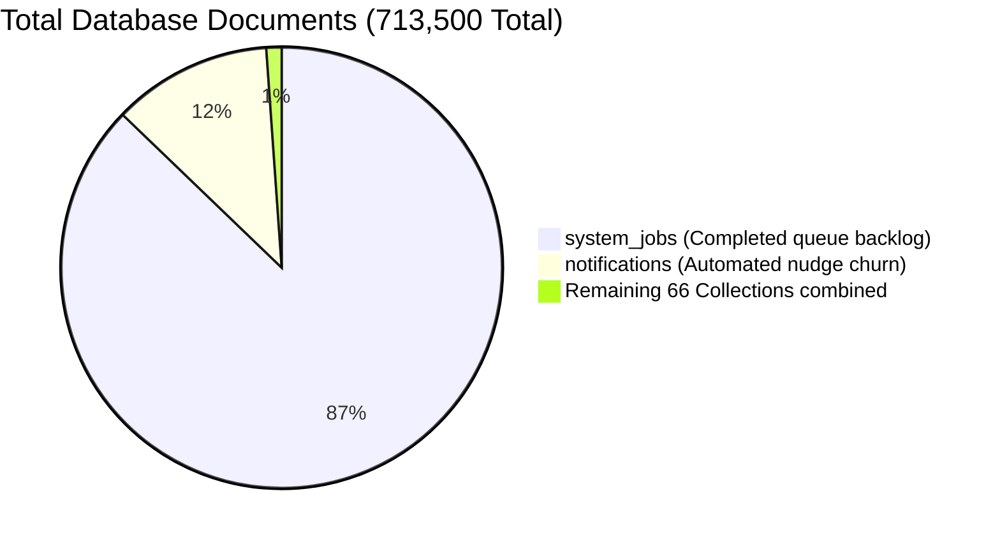

# Enterprise Database Storage Optimization & Data Retention System

## Overview

This repository document set provides an authoritative, evidence-based data retention, storage optimization, and archival governance system for the **Talnova Enterprise Onboarding Platform**.

The platform is running live in production on MongoDB Atlas. Storage consumption has been growing at an unexpected rate, driven primarily by operational background queues and automated notification churn.

This knowledge framework was built following a comprehensive, read-only architectural discovery of the entire production codebase (TypeScript, Fastify, Mongoose) and all **68 MongoDB collections** in the live database cluster (`Talnova-Onboarding`).

---

## Document Index

1. [**Collection Inventory & Catalog (`collection-inventory.md`)**](./collection-inventory.md)
   - Structured metadata, live metrics, ownership, sensitivity, and retention classifications for all 68 discovered collections.
2. [**Machine-Readable Inventory (`collection-inventory.json`)**](./collection-inventory.json)
   - Machine-parseable JSON schema containing full statistics, index definitions, and classification flags.
3. [**Data Retention & Archival Policies (`retention-policy.md`)**](./retention-policy.md)
   - Formal retention rules, statutory compliance requirements (GDPR, SOC2, HIPAA, labor laws), TTL index specifications, and backup-and-purge workflows.
4. [**Storage Inefficiency & Bottleneck Analysis (`storage-analysis.md`)**](./storage-analysis.md)
   - Deep dive into unbounded queue accumulation, missing TTL expiration timestamps, index overhead vs. data size, orphaned records, and estimated savings.
5. [**Super Admin Backup & Purge Architecture (`backup-and-purge-design.md`)**](./backup-and-purge-design.md)
   - End-to-end design for verified, tamper-resistant, bounded, resumable backups and purges with cryptographic checksums and cold storage manifests.
6. [**Implementation Plan (`implementation-plan.md`)**](./implementation-plan.md)
   - Dependency-aware, 6-milestone executable roadmap with exact file paths, migration scripts, unit/integration tests, and rollback procedures.
7. [**Architecture Decision Log (`decision-log.md`)**](./decision-log.md)
   - Formal ADRs for TTL indexing, batch sizing, outbox event pruning, and immutable audit log compliance.
8. [**Verification, Testing & Rollback Runbook (`verification-and-rollback.md`)**](./verification-and-rollback.md)
   - Pre-flight checks, dry-run instructions, monitoring queries, and step-by-step recovery procedures.
9. [**Agent Self-Learning & Drift Log (`agent-learning-log.md`)**](./agent-learning-log.md)
   - Continuous inspection log comparing inventory snapshots, schema evolution, and index drift across agent runs.

---

## Key Discovery Findings

1. **The "System Logs" Root Cause**: The user-reported "system_logs (~608k docs)" is physically `system_jobs` in MongoDB (622,103 documents, 233.6 MB data, 51.7 MB index storage). It functions as an in-database queue for background schedulers, outbox publishers, and kiosk health sweeps. **621,955 jobs are in `completed` status**, retained indefinitely because no cleanup job or TTL index was ever attached to `completedAt`.
2. **The "Notifications" Root Cause**: `notifications` has accumulated 83,394 documents (77.6 MB data, 7.1 MB index storage). While a TTL index exists on `{ expiresAt: 1 }`, **80,407 records (96.4%) have `expiresAt: null`**, rendering the TTL completely inoperable for scheduled reminder notifications.
3. **Storage Concentration**: Two collections (`system_jobs` and `notifications`) account for **98.9% of all documents** and **98.3% of all logical database data** (311.2 MB out of 316.5 MB).
4. **Index Bloat**: Total index storage across the database (67.8 MB) exceeds compressed collection storage (57.2 MB) due to multiple overlapping compound indexes on high-churn collections.

---

## Strategy Classification Summary

| Strategy | Description | Collection Count | Primary Collections |
| :--- | :--- | :---: | :--- |
| **Strategy A: Automatic Expiration (TTL)** | Ephemeral operational records with verified short lifecycles | **12** | `outbox_events`, `kiosk_device_telemetry`, `feature_usage_records`, `alerts`, `kiosksessions`, `kioskanalytics`, `hriswebhooklogs`, `sessions`, `synclogs`, `workflow_execution_logs`, `kiosk_pairing_codes`, `demotenants` |
| **Strategy B: Super Admin Backup & Purge** | Compliance or financial records requiring verified cold archival before purge | **7** | `auditLogs`, `payment_records`, `expense_records`, `invoices`, `onboarding_health`, `ai_usage_records`, `kioskemergencies` |
| **Strategy C: Both TTL & Backup/Purge** | High-volume operational data with immediate TTL for new records and batch purge for historical backlog | **2** | `system_jobs` (622k backlog), `notifications` (83k backlog) |
| **Strategy D: Retain Under Controlled Policy** | Core business domain models, configurations, templates, and active user onboarding state | **45** | `users`, `organizations`, `journeys`, `tasks`, `employeeAssignments`, `employeemilestones`, `milestonetemplates`, `documents`, `certificates`, etc. |
| **Strategy E: Investigate Before Deciding** | Legacy bootstrap or empty orphaned collections | **2** | `platform_feature_flags` (legacy startup bootstrap), `paymentrecords` (0 docs, obsolete legacy schema) |
| **Total** | **All Discovered Collections** | **68** | |

---

## Storage Reclamation Potential

| Target Collection | Current Documents | Purgeable / Expiring | Estimated Logical Space Reclaimed | Estimated Index Space Reclaimed | Confidence |
| :--- | :---: | :---: | :---: | :---: | :---: |
| `system_jobs` | 622,103 | ~621,000 (completed > 7d) | ~230.0 MB | ~50.0 MB | **High (Verified)** |
| `notifications` | 83,394 | ~80,000 (read/stale > 90d) | ~72.0 MB | ~6.5 MB | **High (Verified)** |
| `outbox_events` | 1,402 | ~1,400 (published > 7d) | ~0.6 MB | ~0.3 MB | **High (Verified)** |
| `paymentrecords` | 0 | Drop empty legacy collection | 0 MB | 0.01 MB | **High (Verified)** |
| **Total Immediate Potential** | **~707,000 docs** | **~702,400 docs (98.4%)** | **~302.6 MB (95.6%)** | **~56.8 MB (83.8%)** | **High** |

*Note: In MongoDB WiredTiger, deleting documents returns pages to the internal storage allocation pool. Reclaiming physical disk space back to the underlying operating system filesystem requires compacting or collection re-indexing, but WiredTiger will immediately reuse freed space for newly enqueued records without requiring database file expansion.*
