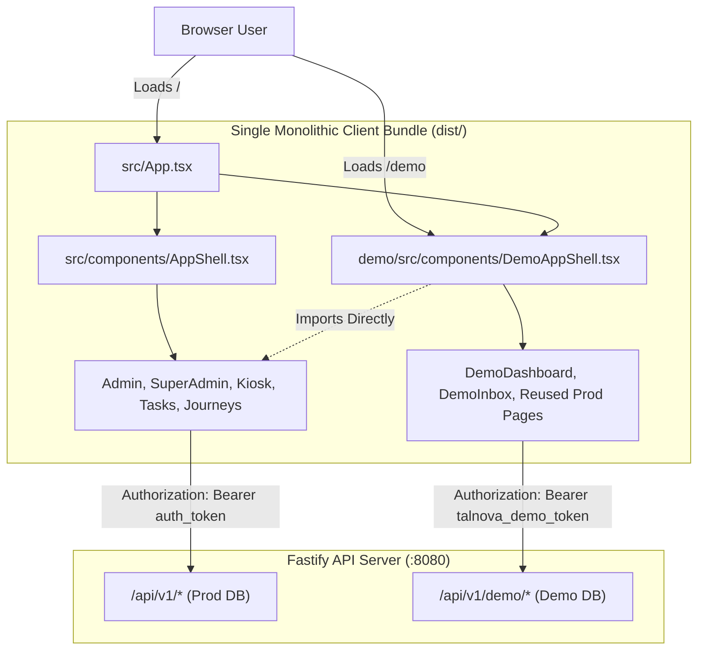

# Talnova Onboarding: Repository Discovery & Architecture Report

**Document ID:** `TALNOVA-DEMO-DISCOVERY-001`  
**Phase:** Zero (Repository Discovery)  
**Status:** Complete  
**Date:** 2026-10-17  
**Author:** Principal Software Architect & Full-Stack Security Engineering Team  

---

## 1. Executive Summary

This discovery report provides a comprehensive, verified investigation into the **Talnova Onboarding** enterprise application repository. The primary objective is to separate the existing demo environment from the production application, establish true-to-life demo feature parity without exposing production credentials or data, eliminate unintended redirects from demo routes to production login/registration, enable independent frontend builds and deployments, and establish rigorous security boundaries around the shared backend.

All findings in this document are grounded in explicit code inspections of `d:/talnova/talnova-onboarding`, covering client-side React routes, Axios interceptors, authentication context, state stores, backend Fastify route trees, Mongoose database pools, and deployment configurations.

---

## 2. Verified Technology Stack & Repository Topology

### 2.1 Workspace Structure

```
d:/talnova/talnova-onboarding/
├── .env / .env.example              # Client runtime environment configuration
├── package.json                    # Frontend dependencies and scripts (Vite 5, React 18)
├── tsconfig.json                   # TypeScript project configuration
├── vite.config.ts                  # Root Vite configuration with /api proxy to :8080
├── tailwind.config.js              # Tailwind CSS 3.4 styling tokens
├── index.html                      # Root SPA entrypoint (/src/index.tsx)
├── src/                            # Production Client Application
│   ├── App.tsx                     # Master React Router (v6) route tree
│   ├── index.tsx                   # ReactDOM bootstrap
│   ├── api/
│   │   └── client.ts               # Centralized Axios client & interceptors
│   ├── components/                 # Shared UI components (AppShell, Sidebar, Button, Modals)
│   ├── context/                    # RoleContext, LanguageContext, SuperAdminFilterContext
│   ├── features/                   # Kiosk feature module (PWA, heartbeat, scanner)
│   ├── hooks/                      # useAuth, useSessionTimeout, useSettings, etc.
│   ├── pages/                      # Production screens (Admin, Employee, SuperAdmin, KB, etc.)
│   └── services/                   # Frontend API services (auth, journeys, sso, etc.)
├── demo/                           # Existing Demo Subsystem (Frontend)
│   └── src/
│       ├── components/             # DemoAppShell, DemoWatermark, DemoRestrictedModal
│       ├── context/                # DemoAuthContext (token, user, tenant, persona switcher)
│       ├── hooks/                  # useDemoTelemetry
│       └── pages/                  # DemoDashboard, DemoInbox, DemoLogin
├── server/                         # Backend Application (Fastify 5 + Mongoose 8)
│   ├── package.json                # Backend dependencies (tsx, fastify, mongoose, zod)
│   ├── src/
│   │   ├── app.ts                  # Fastify server bootstrap & route registration
│   │   ├── server.ts               # HTTP listen entrypoint
│   │   ├── config/                 # Env validation schema (Zod), logger, storage
│   │   ├── database/               # Mongoose connections (production + demo pool)
│   │   └── modules/
│   │       ├── auth/               # Production JWT, SSO, invitations, sessions
│   │       ├── demo/               # Isolated Demo Subsystem
│   │       │   ├── controllers/    # demoAppController (scoped synthetic handlers)
│   │       │   ├── database/       # demoConnection pool (strictly separate DB)
│   │       │   ├── middleware/     # demoAuthenticate, demoGuard, demoWatermark
│   │       │   ├── models/         # DemoSession, DemoTelemetry, DemoAudit, etc.
│   │       │   ├── routes/         # /api/v1/demo/* & /api/v1/super-admin/demo/*
│   │       │   ├── seed/           # Deterministic personas (Sarah, John, Alice, Bob)
│   │       │   └── services/       # 10-step atomic reset engine, demo auth
│   │       ├── super-admin/        # Super Admin management APIs
│   │       └── ... (24 enterprise business modules)
└── docs/                           # Architecture, specifications, and runbooks
```

### 2.2 Framework & Dependency Versions (Verified)

| Subsystem | Technology | Version | Key Notes |
| :--- | :--- | :--- | :--- |
| **Frontend Core** | React / React DOM | `^18.3.1` | Client-rendered SPA |
| **Routing** | `react-router-dom` | `^6.26.2` | Browser history routing |
| **State & Cache** | `@tanstack/react-query` | `^5.101.1` | Server-state caching |
| **HTTP Client** | `axios` | `^1.18.1` | Custom interceptors in `src/api/client.ts` |
| **Build Tool** | `vite` | `^5.2.0` | Rollup-based manual chunking configured |
| **Styling** | `tailwindcss` | `3.4.17` | Utility-first with clsx + tailwind-merge |
| **Backend Framework**| `fastify` | `^5.1.0` | High-throughput asynchronous HTTP API |
| **Data Layer** | `mongoose` | `^8.8.2` | Dual connection pool architecture |
| **Validation** | `zod` | `^3.23.8` (server), `^4.4.3` (client dev) | Strict runtime schema enforcement |
| **Token Verification**| `@fastify/jwt` | `^9.0.1` | Dual secret separation (Prod vs Demo) |

---

## 3. Current Production vs. Demo Relationship

### 3.1 Architectural Coupling Summary

Currently, the demo frontend is not a separate application bundle. It is embedded directly inside the production router at `/demo` and `/demo/*` within `src/App.tsx`.



### 3.2 Coupling Dimensions

1. **Routing Intertwining (`src/App.tsx`):**
   - The production router declares `/demo/login` and `/demo/*` alongside `/login`, `/register`, `/super-admin/*`, and `/kiosk/*`.
   - The `/demo` route lacks a fallback catch-all handler (`path="*"`). Unmatched demo paths cascade directly into the root layout (`Route path="/" element={<AppShell />}`), which redirects unauthenticated requests to `/login`.
2. **Global Axios Interceptor (`src/api/client.ts`):**
   - Requests on `/demo` routes inject `talnova_demo_token` and rewrite paths (e.g. `/journeys` $\rightarrow$ `/demo/journeys`).
   - On a `401 Unauthorized` response, the interceptor attempts a token refresh at the production endpoint `${API_BASE_URL}/auth/refresh`. When this inevitably fails for demo tokens, it unconditionally executes `window.location.href = '/login'`, ripping the demo user out of the demo environment and placing them on the production login screen.
3. **Internal Hardcoded Navigation in Production Pages:**
   - Pages such as `JourneyBuilder.tsx` (`navigate('/journeys')`), `DocumentSigner.tsx` (`navigate('/documents')`), `CourseViewer.tsx` (`navigate('/employee')`), `EmployeeProfile.tsx` (`navigate('/employee')`), and `Settings.tsx` (`navigate('/settings/sso')`) contain root-relative navigation commands.
   - When rendered inside the demo environment, clicking back, cancel, or complete triggers a jump to production routes (`/journeys`, `/documents`), which requires production authentication and redirects to `/login`.
4. **Local Storage Collisions:**
   - `DemoAuthContext.tsx` sets `localStorage.setItem('user_role', normalizedRole)` and `'user_roles'`. These keys overlap with production authentication keys, causing state pollution across sessions if an administrator tests both environments in the same browser.

---

## 4. Backend Isolation Architecture (Verified)

Unlike the frontend, the backend demonstrates clean physical and logical database isolation as verified in `server/src/modules/demo/`:

1. **Distinct Database Pools:**
   - Production operations use `mongoose.connection` pointed at `MONGODB_URI`.
   - Demo operations strictly utilize `demoConnection` derived from `DEMO_DATABASE_URL` (in `server/src/modules/demo/database/demo-connection.ts`).
   - If `DEMO_DATABASE_URL` is unreachable or missing, demo requests fail with `503 Service Unavailable (DEMO_DB_DISCONNECTED)`. Under no circumstances is fallback to the production database permitted.
2. **Cryptographic Secret Separation:**
   - Production uses `JWT_SECRET` and `JWT_REFRESH_SECRET`.
   - Demo uses `DEMO_JWT_SECRET` and `DEMO_JWT_REFRESH_SECRET`.
   - Demo tokens carry `{ isDemo: true, tenantId, sessionId, role }`. Production endpoints reject tokens signed with demo secrets, and demo endpoints reject production tokens.
3. **10-Step Deterministic Reset Engine:**
   - Implemented in `server/src/modules/demo/services/demo-reset.service.ts`.
   - Guards verify that `demoConnection.name !== mongoose.connection.name` before executing drops and reseeds, preventing accidental destruction of production data.

---

## 5. Verified Files Requiring Modifications

| File Path | Nature of Necessary Change |
| :--- | :--- |
| `src/api/client.ts` | Scope 401 refresh/redirect logic so `/demo` paths never redirect to `/login` or call `/auth/refresh`. Handle demo session expiration cleanly. |
| `src/App.tsx` | Isolate demo routes; add demo-local catch-all route (`*`); remove dependencies that cause production fallback. |
| `src/components/ProtectedRoute.tsx` | Support demo-aware redirection (`/demo` instead of `/`) when capability checks fail. |
| `src/hooks/useSessionTimeout.ts` | Guard against demo routes or integrate with demo inactivity timers (`/demo/login` rather than `/login`). |
| `demo/src/context/DemoAuthContext.tsx` | Isolate storage keys (use `demo_user_role` or scoped storage); prevent collision with production session keys. |
| `demo/src/components/DemoAppShell.tsx` | Expand navigation to achieve feature parity; handle demo 404, 403, and 500 error boundaries; support persona-aware journeys. |
| `demo/src/components/DemoRestrictedPage.tsx` | Refine guidance modal and ensure back/return buttons stay within `/demo`. |
| `demo/src/pages/` (New Pages) | Implement missing demo-scoped pages: `DemoNotFound`, `DemoAccessDenied`, `DemoErrorPage`, `DemoCertificates`, `DemoWorkflows`, `DemoOfficeMap`. |
| `vite.demo.config.ts` (New Target) | Provide standalone Vite build target compiling solely the demo frontend to `dist-demo/`. |
| `demo/index.html` (New Entrypoint) | Provide standalone HTML entry point for the independent demo application. |

---

## 6. Facts Verified from Code vs. Assumptions Requiring Confirmation

### Facts Verified from Code
1. `src/api/client.ts` (lines 177–217) is the direct root cause of demo users being redirected to `/login` upon 401 responses.
2. Production components reused in the demo use hardcoded `navigate('/...')` calls that bypass the `/demo` prefix.
3. `/demo` inside `src/App.tsx` lacks a nested catch-all route (`<Route path="*" ... />`), causing any unmatched demo URL to fall back to the production root (`/`), triggering `AppShell` redirect to `/login`.
4. The backend demo database connection is completely isolated and cannot contaminate production MongoDB.
5. The backend already supports extensive demo APIs (`/api/v1/demo/*`) covering journeys, tasks, directory, documents, KB, analytics, buddy, milestones, and inbox.

### Assumptions Requiring Confirmation
1. **Hosting & Subdomain Strategy:** Will the demo frontend be hosted on a dedicated subdomain (e.g. `demo.talnova.com` or `demo.talnova.io`) or remain a subpath (`/demo`) on the primary domain?
2. **Kiosk Mode in Demo:** Should Kiosk Terminal functionality be intentionally excluded from the sales demo, or demonstrated via an interactive preview simulator?
3. **Super Admin Access in Demo:** Confirmed as production-only; should any simplified read-only admin preview be exposed in demo, or strictly omitted? (Recommendation: strictly omitted from demo frontend).

---

## 7. Discovery Conclusion

The root cause of unwanted redirects and coupling is isolated to frontend routing rules, global Axios response interceptors, hardcoded relative navigation, and the absence of demo-specific error/fallback routes. The backend is well-isolated. A clean separation can be achieved by decoupling the demo frontend into an independently buildable target with demo-aware navigation wrappers and isolated interceptors.
