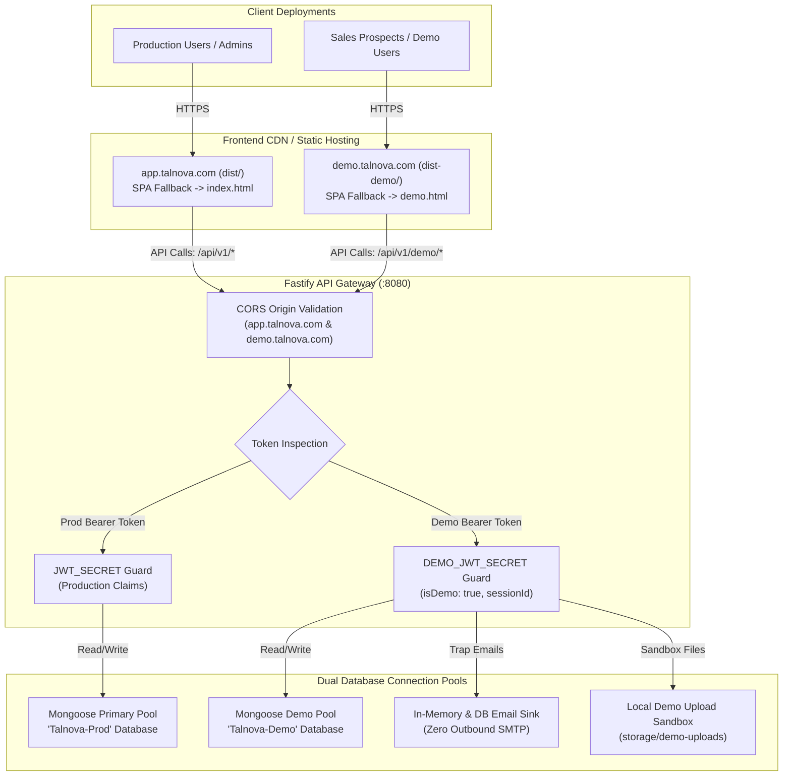

# Target Architecture: Independent Demo Application

**Document ID:** `TALNOVA-DEMO-ARCH-004`  
**Phase:** Three (Target Architecture Design)  
**Status:** Approved Architecture Draft  
**Date:** 2026-10-17  
**Author:** Principal Software Architect & Deployment Engineering Lead  

---

## 1. Architectural Vision

The target architecture establishes the **Talnova Demo Environment** as an independently buildable, deployable frontend application that interacts securely with the shared backend API. It decouples the demo presentation layer from the production client application, guarantees that demo error handling remains strictly self-contained, and preserves backend authorization and data isolation.

---

## 2. Core Architectural Principles

1. **Independent Build Target & Artifact:**  
   The demo frontend builds through a dedicated Vite configuration (`vite.demo.config.ts`) outputting directly to `dist-demo/`. The resulting static bundle contains zero references to production super-admin dashboards, production user management, or billing systems.
2. **Context-Aware Routing & Self-Contained Fallbacks:**  
   The demo router owns its entire URL space (`/` when deployed on a dedicated demo domain, or `/demo/*` when deployed on a path prefix). All error states (401, 403, 404, 500) render demo-branded pages. Under no circumstances does a demo error redirect to production `/login` or `/register`.
3. **Storage & Session Sandboxing:**  
   All client storage keys are namespaced with `talnova_demo_` (`talnova_demo_token`, `talnova_demo_user`, `talnova_demo_role`). Browser storage collisions with production users are physically eliminated.
4. **Physical & Logical Backend Isolation:**  
   The demo frontend interacts exclusively with `/api/v1/demo/*`. The backend enforces that demo tokens signed with `DEMO_JWT_SECRET` can only access the `demoConnection` MongoDB pool.
5. **Deterministic Baseline & 1-Click Reset:**  
   A 10-step atomic reset engine resets the synthetic demo database to the baseline state without downtime or production impact.

---

## 3. High-Level Target Architecture Diagram

---

## 4. Subsystem Specifications

### 4.1 Frontend Build & Entry Points

- **Configuration:** `vite.demo.config.ts`
- **Entry HTML:** `demo/index.html` (referencing `demo/src/main.tsx`)
- **Build Output:** `dist-demo/`
- **Build Script:** `npm run build:demo`
- **Preview Script:** `npm run preview:demo`
- **Chunk Optimization:** Vendor separation for React, Lucide Icons, Recharts, and TanStack Query, completely omitting heavy admin/production libraries.

### 4.2 Independent Routing & Error Boundaries

- **Root Routing:** Root `/` in the demo application routes to `DemoDashboardRedirect` (routing to `/admin`, `/manager`, or `/employee` based on active persona).
- **Demo 404 Handler:** `<Route path="*" element={<DemoNotFound />} />` renders a branded 404 view with options to return to the active dashboard or switch personas.
- **Demo 401 Handler:** Intercepts expired demo tokens; clears `talnova_demo_*` storage keys; displays `DemoSessionExpiredModal` or routes to `/login` within the demo host.
- **Demo 403 Handler:** Renders `DemoAccessDenied` or the non-intrusive `DemoRestrictedModal` displaying upgrade intent signals and recording telemetry.
- **Demo 500 / Error Boundary:** Global React `DemoErrorBoundary` traps component crashes and provides a 1-click "Reset State to Baseline" or "Reload Demo" action.

### 4.3 Storage & Session Lifecycle

| Key | Purpose | Scope |
| :--- | :--- | :--- |
| `talnova_demo_token` | Demo Access JWT signed with `DEMO_JWT_SECRET` | LocalStorage |
| `talnova_demo_user` | Active Persona Profile (Sarah, John, Alice, Bob) | LocalStorage |
| `talnova_demo_tenant` | Active Tenant Entitlement (`acme-corp` / `globex-ind`) | LocalStorage |
| `talnova_demo_role` | Active normalized role (`admin`, `manager`, `employee`) | LocalStorage |
| `talnova_demo_watermark` | Tamper-resistant attribution watermark metadata | LocalStorage |

---

## 5. Security Architecture & Threat Modeling

1. **Token Forgery Mitigation:**  
   Backend tests (`demo-security-boundaries.test.ts`) verify that tokens forged with production secrets are rejected by demo routes with 401, and demo tokens are rejected by production routes.
2. **Cross-Tenant Isolation:**  
   Every demo database query is strictly filtered by `demoTenantId`. A prospect in Globex Industries cannot access Acme Corp candidates, tasks, or documents.
3. **Outbound Data Leakage Prevention:**  
   Live SMTP dispatch is completely bypassed in demo mode. The `DemoEmailSinkService` routes all notification events to an in-memory ring buffer and synthetic database collection accessible via `/demo/inbox`.
4. **Content Security Policy (CSP):**  
   Strict CSP headers restrict connect-src to designated API domains, script-src to `'self'`, and block framing except from authorized enterprise sales portals.

---

## 6. Deployment Topology Options

| Option | Architecture | Feasibility | Recommendation |
| :--- | :--- | :--- | :--- |
| **Option A: Dedicated Subdomain (`demo.talnova.com`)** | Distinct DNS, isolated origin, independent Netlify/Vercel/S3 bucket serving `dist-demo/` | High | **Recommended:** Complete cookie/origin isolation; zero possibility of production routing contamination. |
| **Option B: Subpath Hosting (`talnova.com/demo`)** | Cloudflare / Nginx reverse proxy routing `/demo/*` to demo bucket and `/*` to production bucket | Medium | Feasible, but requires precise proxy rewrite rules to prevent fallthrough to production root. |
| **Option C: Monolithic Bundle with Path Flag** | Single bundle serving both apps based on window.location | Low | Rejected: Violates requirement for independent frontend build and exposes prod code. |
