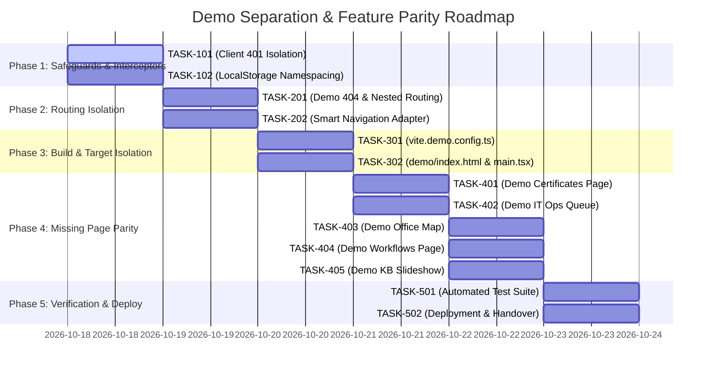

# Enterprise Onboarding Demo Separation: Implementation Plan

**Document ID:** `TALNOVA-DEMO-PLAN-005`  
**Phase:** Four (Implementation Planning)  
**Status:** Approved for Execution  
**Date:** 2026-10-17  
**Author:** Principal Software Architect & QA Automation Lead  

---

## 1. Overview & Execution Strategy

This implementation plan decomposes the demo separation and feature parity initiative into 12 controlled, sequential, and independently verifiable phases. Each task is defined with exact file targets, clear acceptance criteria, automated tests, and rollback procedures.

> [!IMPORTANT]  
> Implementation proceeds in strict phase order. No task may be marked `Verified` until its unit and integration tests pass cleanly and no production regressions are observed.

---

## 2. Phased Implementation Roadmap

---

## 3. Detailed Task Specifications

### Phase 1: Baseline Safeguards & Interceptor Isolation

#### Task ID: `TASK-101` — Scope Axios 401 Interceptor and Token Lifecycle
- **Objective:** Eliminate forced redirects to production `/login` on demo 401 responses.
- **Files to Inspect & Modify:**
  - `src/api/client.ts` (Lines 86–140, 175–220)
- **Prerequisites:** None.
- **Implementation Steps:**
  1. Inspect `client.ts` response interceptor.
  2. Detect if active route starts with `/demo`.
  3. If on `/demo`, bypass production `/auth/refresh` call.
  4. Clear demo-specific storage keys (`talnova_demo_*`) without deleting production `auth_token`.
  5. Redirect to `/demo/login?reason=session_expired` or invoke local demo session state handler.
- **Acceptance Criteria:**
  - When a demo API request returns 401, the user is never redirected to `/login` or `/register`.
  - Production requests returning 401 continue to execute `/auth/refresh` and redirect to `/login` as expected.
- **Automated Tests:**
  - `src/tests/demo-routing-isolation.test.ts`: Mock 401 for `/api/v1/demo/tasks`; verify redirect destination is `/demo/login`.
- **Definition of Done:** Interceptor test passes; production 401 tests pass; zero production regressions.

#### Task ID: `TASK-102` — LocalStorage Namespacing & Storage Sandboxing
- **Objective:** Prevent demo logins and role changes from overwriting production `user_role` and `user_roles`.
- **Files to Inspect & Modify:**
  - `demo/src/context/DemoAuthContext.tsx` (Lines 90–108, 110–133)
  - `src/context/RoleContext.tsx`
- **Prerequisites:** `TASK-101`.
- **Implementation Steps:**
  1. Change `localStorage.setItem('user_role', ...)` in `DemoAuthContext.tsx` to `localStorage.setItem('talnova_demo_role', ...)`.
  2. Update `RoleContext.tsx` so that when `window.location.pathname.startsWith('/demo')`, it reads from `talnova_demo_role`.
- **Acceptance Criteria:**
  - Logging in as Bob Vance (Employee) in demo does not alter the active admin session in production.
- **Automated Tests:**
  - Unit test verifying storage keys remain distinct during concurrent simulated logins.
- **Definition of Done:** Independent storage confirmed across sessions.

---

### Phase 2: Routing Isolation & Navigation Adapters

#### Task ID: `TASK-201` — Demo Nested Catch-All & Branded Error Pages
- **Objective:** Provide self-contained demo 404, 403, and 500 error boundaries.
- **Files to Inspect & Modify:**
  - `src/App.tsx` (Lines 125–154)
  - `demo/src/pages/DemoNotFound.tsx` (New)
  - `demo/src/pages/DemoAccessDenied.tsx` (New)
  - `demo/src/components/DemoErrorBoundary.tsx` (New)
- **Prerequisites:** Phase 1.
- **Implementation Steps:**
  1. Create `DemoNotFound.tsx` featuring demo branding, search bar, and "Return to Demo Dashboard" button.
  2. Create `DemoAccessDenied.tsx` explaining role entitlement with persona switcher shortcut.
  3. Create `DemoErrorBoundary.tsx` providing safe recovery actions (Reload, Reset Demo).
  4. Mount `<Route path="*" element={<DemoNotFound />} />` inside `<Route path="/demo">`.
- **Acceptance Criteria:**
  - Requesting `/demo/invalid-url-test` renders `DemoNotFound`. It does not fall through to production root or `/login`.
- **Automated Tests:**
  - Route test loading invalid demo URL; verify `DemoNotFound` rendered.
- **Definition of Done:** Error boundary and 404 routes render and pass component tests.

#### Task ID: `TASK-202` — Context-Aware Navigation Adapter
- **Objective:** Fix hardcoded root-relative navigation in reused production components (`JourneyBuilder`, `DocumentSigner`, `CourseViewer`, `Settings`).
- **Files to Inspect & Modify:**
  - `demo/src/components/DemoAppShell.tsx`
  - `src/hooks/useSmartNavigate.ts` (New utility) or Demo Navigation Context Provider
- **Prerequisites:** `TASK-201`.
- **Implementation Steps:**
  1. Create a transparent navigation helper or wrap the demo route tree in a custom router context that prefixes internal navigation with `/demo`.
  2. Alternatively, update `JourneyBuilder.tsx` and `DocumentSigner.tsx` to use relative navigation (`navigate('..')` or `navigate('/demo/journeys')` when `isDemo`).
- **Acceptance Criteria:**
  - In `JourneyBuilder`, clicking "Save & Close" routes to `/demo/journeys`.
  - In `DocumentSigner`, clicking "Back to Documents" routes to `/demo/documents`.
- **Automated Tests:**
  - Render `JourneyBuilder` under demo wrapper; trigger back; assert URL is `/demo/journeys`.
- **Definition of Done:** Zero unexpected transitions out of demo during normal workflow completion.

---

### Phase 3: Independent Build Target & Standalone Entrypoint

#### Task ID: `TASK-301` — Standalone Demo Vite Configuration
- **Objective:** Provide a separate build command `npm run build:demo` producing `dist-demo/`.
- **Files to Inspect & Modify:**
  - `vite.demo.config.ts` (New)
  - `package.json` (Scripts addition: `build:demo`, `preview:demo`)
- **Prerequisites:** Phase 2.
- **Implementation Steps:**
  1. Author `vite.demo.config.ts` with entry root pointed to `demo/`.
  2. Configure manual Rollup chunks for lean demo bundle.
  3. Ensure production Super Admin components are excluded from the demo build tree.
- **Acceptance Criteria:**
  - Running `npm run build:demo` completes cleanly with exit code 0 and populates `dist-demo/`.
  - `dist-demo/` contains only demo assets and referenced shared components.
- **Definition of Done:** Standalone build output verified.

#### Task ID: `TASK-302` — Standalone Demo HTML Entrypoint
- **Objective:** Provide `demo/index.html` and `demo/src/main.tsx` for standalone deployment.
- **Files to Inspect & Modify:**
  - `demo/index.html` (New)
  - `demo/src/main.tsx` (New)
- **Prerequisites:** `TASK-301`.
- **Implementation Steps:**
  1. Create `demo/index.html` with demo metadata, OpenGraph tags, and favicon.
  2. Create `demo/src/main.tsx` bootstrapping `QueryClientProvider`, `DemoAuthProvider`, and demo-specific router.
- **Acceptance Criteria:**
  - `dist-demo/index.html` can be served by any static web server and loads the demo independently.
- **Definition of Done:** Demo preview server loads at `http://localhost:5174` independently.

---

### Phase 4: Page & Feature Parity Implementation

#### Task ID: `TASK-401` — Mount Demo Certificates
- **Objective:** Enable certificate viewing and downloading in demo.
- **Files:** `src/App.tsx`, `demo/src/components/DemoAppShell.tsx`, `src/pages/Certificates.tsx`.
- **Acceptance:** `/demo/certificates` renders certificates list with demo graduation badges.

#### Task ID: `TASK-402` — Mount Demo IT Operations Hardware Queue
- **Objective:** Support IT admin persona demonstrating laptop provisioning and hardware receipts.
- **Files:** `src/App.tsx`, `demo/src/components/DemoAppShell.tsx`, `src/pages/Tasks.tsx`.
- **Acceptance:** `/demo/tasks/it-ops` renders hardware fulfillment queues with action buttons.

#### Task ID: `TASK-403` — Mount Demo Office Floor Map
- **Objective:** Showcase interactive office desk booking.
- **Files:** `src/App.tsx`, `demo/src/components/DemoAppShell.tsx`, `src/pages/OfficeMap.tsx`.
- **Acceptance:** `/demo/office-map` renders interactive floor plan with synthetic allocations.

#### Task ID: `TASK-404` — Mount Demo Automated Workflows
- **Objective:** Showcase onboarding trigger rules and automated workflows.
- **Files:** `src/App.tsx`, `demo/src/components/DemoAppShell.tsx`, `src/pages/Workflows.tsx`.
- **Acceptance:** `/demo/workflows` renders workflow rules list and condition builders.

#### Task ID: `TASK-405` — Mount Demo Knowledge Base Slideshow
- **Objective:** Enable full-screen interactive slide presentations from the demo KB.
- **Files:** `src/App.tsx`, `src/pages/KnowledgeBaseSlideshow.tsx`.
- **Acceptance:** Clicking "Start Slideshow" in demo KB opens `/demo/kb/slideshow` without ejecting to production.

---

### Phase 5: Verification, Security Review & Handover

#### Task ID: `TASK-501` — Comprehensive Automated Regression Suite
- **Objective:** Create and execute frontend tests verifying routing, error handling, and security boundaries.
- **Files:** `src/tests/demo-routing-isolation.test.tsx` (New).
- **Acceptance:** All demo frontend tests pass; existing 500+ production tests continue to pass; 34 backend demo tests pass.

#### Task ID: `TASK-502` — Final Handover & Deployment Runbook
- **Objective:** Deliver the final audit report, release checklist, and rollback documentation.
- **Files:** `docs/demo-separation/07-final-handover.md`, `docs/demo-separation/README.md`.
- **Acceptance:** Complete operational documentation delivered.
