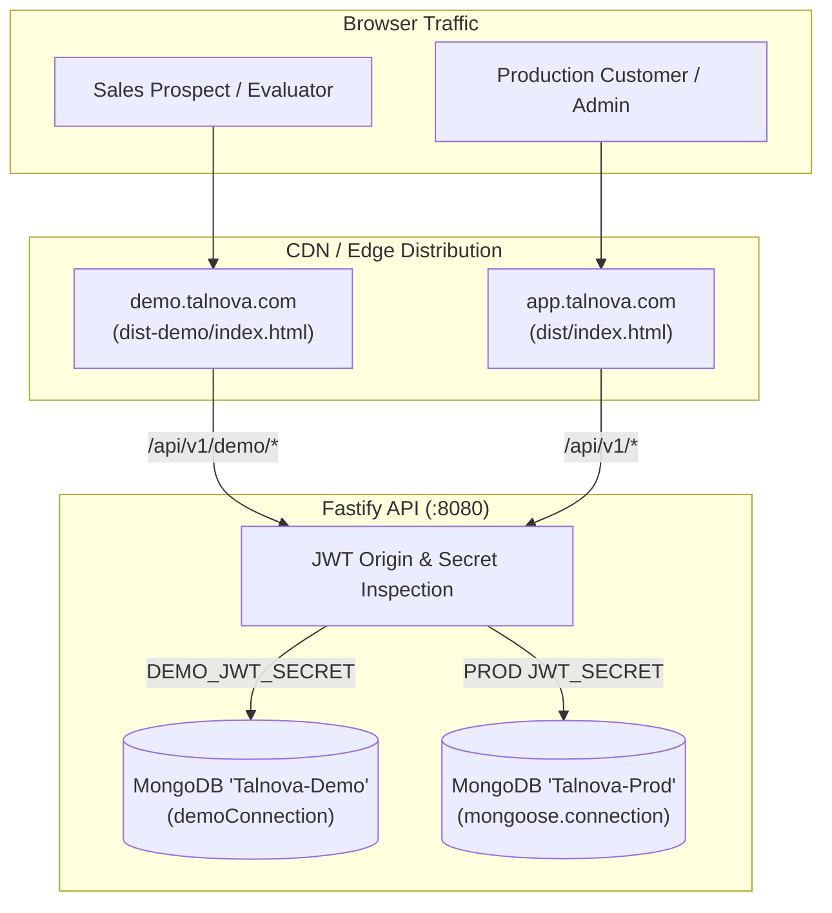

# Talnova Demo Environment: Production Release & Deployment Runbook

**Document ID:** `TALNOVA-DEMO-RUNBOOK-007`  
**Phase:** Five (Release Readiness & Deployment Execution)  
**Status:** Approved for Production Deployment  
**Date:** 2026-10-17  
**Author:** Principal Software Architect & Release Engineering Lead  

---

## 1. Overview & Architectural Scope

This runbook defines the exact operational procedures required to build, test, deploy, and maintain the standalone **Talnova Interactive Demo Environment** (`dist-demo/`).

### Target Deployment Topology (Option A - Recommended)
- **Production Origin:** `https://app.talnova.com` (serving `dist/` from primary S3/CDN bucket)
- **Demo Origin:** `https://demo.talnova.com` (serving `dist-demo/` from isolated demo CDN bucket)
- **Shared API Gateway:** `https://api.talnova.com` (Fastify gateway with dual database connection pools: production MongoDB vs `demoConnection` MongoDB)



---

## 2. Independent Build & Packaging Instructions

The demo frontend is built independently of production code. It excludes all super-admin consoles, kiosk hardware drivers, and billing modules.

```bash
# 1. Clean previous build artifacts
rm -rf dist-demo

# 2. Execute standalone demo build
npm run build:demo

# 3. Verify output integrity
ls -la dist-demo/
```

### Verified Build Artifact Output
- `dist-demo/index.html` (~1.00 kB): Standalone HTML entrypoint with `<meta name="robots" content="noindex, nofollow" />`.
- `dist-demo/assets/index-*.js` (~1.25 MB minified / ~290 kB gzipped): Lean demo bundle (over **1.45 MB smaller** than production `dist/`).
- `dist-demo/assets/index-*.css` (~181 kB): Full Tailwind CSS bundle including demo micro-animations.
- `dist-demo/locales/`: Complete multi-language i18n dictionary.
- `dist-demo/_redirects`: SPA routing fallback rule.

---

## 3. Hosting & CDN Configuration Specifications

### 3.1 Netlify (`_redirects` / `netlify.toml`)

Place or ensure `dist-demo/_redirects` contains:
```text
/*    /index.html   200
```

`netlify.toml` build settings for `demo.talnova.com`:
```toml
[build]
  publish = "dist-demo"
  command = "npm run build:demo"

[[headers]]
  for = "/*"
  [headers.values]
    X-Frame-Options = "SAMEORIGIN"
    X-Content-Type-Options = "nosniff"
    Referrer-Policy = "strict-origin-when-cross-origin"
    X-Robots-Tag = "noindex, nofollow"
```

---

### 3.2 Cloudflare Pages / Vercel (`vercel.json`)

```json
{
  "buildCommand": "npm run build:demo",
  "outputDirectory": "dist-demo",
  "rewrites": [
    { "source": "/(.*)", "destination": "/index.html" }
  ],
  "headers": [
    {
      "source": "/(.*)",
      "headers": [
        { "key": "X-Robots-Tag", "value": "noindex, nofollow" },
        { "key": "Cache-Control", "value": "public, max-age=0, must-revalidate" }
      ]
    },
    {
      "source": "/assets/(.*)",
      "headers": [
        { "key": "Cache-Control", "value": "public, max-age=31536000, immutable" }
      ]
    }
  ]
}
```

---

### 3.3 AWS S3 + CloudFront Deployment

1. **S3 Bucket:** `s3://talnova-demo-frontend-prod`
2. **Sync Command:**
   ```bash
   aws s3 sync dist-demo/ s3://talnova-demo-frontend-prod --delete --cache-control "public, max-age=31536000, immutable" --exclude "index.html" --exclude "*.json"
   aws s3 cp dist-demo/index.html s3://talnova-demo-frontend-prod/index.html --cache-control "no-cache, no-store, must-revalidate"
   ```
3. **CloudFront Custom Error Response:**
   - HTTP Error Code: `403: Forbidden` & `404: Not Found`
   - Response Page Path: `/index.html`
   - HTTP Response Code: `200: OK`

---

### 3.4 NGINX Reverse Proxy Block (Dedicated Demo Virtual Host)

```nginx
server {
    listen 443 ssl http2;
    server_name demo.talnova.com;

    ssl_certificate /etc/letsencrypt/live/demo.talnova.com/fullchain.pem;
    ssl_certificate_key /etc/letsencrypt/live/demo.talnova.com/privkey.pem;

    root /var/www/talnova/dist-demo;
    index index.html;

    # Security Headers
    add_header X-Frame-Options "SAMEORIGIN" always;
    add_header X-Content-Type-Options "nosniff" always;
    add_header X-Robots-Tag "noindex, nofollow" always;

    # SPA Routing Fallback
    location / {
        try_files $uri $uri/ /index.html;
    }

    # API Gateway Proxy (rewriting /api to backend gateway)
    location /api/ {
        proxy_pass http://127.0.0.1:8080/api/;
        proxy_http_version 1.1;
        proxy_set_header Upgrade $http_upgrade;
        proxy_set_header Connection 'upgrade';
        proxy_set_header Host $host;
        proxy_set_header X-Real-IP $remote_addr;
        proxy_set_header X-Forwarded-For $proxy_add_x_forwarded_for;
        proxy_set_header X-Forwarded-Proto $scheme;
    }

    # Cache static assets
    location /assets/ {
        expires 1y;
        add_header Cache-Control "public, immutable";
    }
}
```

---

## 4. Backend Environment Variables Matrix

| Variable | Target Scope | Description | Sample / Required Setting |
| :--- | :---: | :--- | :--- |
| `DEMO_DATABASE_URL` | Server | Isolated MongoDB connection string for demo data | `mongodb://localhost:27017/talnova_demo` |
| `DEMO_JWT_SECRET` | Server | Cryptographic signing key for demo personas | Distinct 64-char high-entropy string |
| `DEMO_ENABLED` | Server | Master toggle enabling demo endpoint handlers | `true` |
| `CORS_ORIGIN` | Server | Allowed client origins | `https://app.talnova.com,https://demo.talnova.com` |
| `VITE_IS_DEMO_BUILD` | Client Build | Injected compile-time demo flag | `true` |
| `VITE_API_BASE_URL` | Client Build | Base URL for API requests | `/api/v1` |

---

## 5. Post-Deployment Smoke Verification (5-Minute Test Run)

Execute these validation checks immediately following CDN deployment:

1. **Homepage Load:**
   - Navigate to `https://demo.talnova.com/login` (or `/login`).
   - Verify page title is `Talnova Enterprise Demo`.
   - Inspect network request: verify no requests are made to `/api/v1/auth/refresh`.
2. **Persona Switching:**
   - Click "Sarah Connor (Admin)". Verify dashboard renders at `/demo` or `/admin`.
   - Click top persona switcher, switch to "John Doe (Employee)". Verify role changes instantly without full reload.
3. **Parity Routes Verification:**
   - Navigate to `https://demo.talnova.com/demo/certificates`. Verify verified credentials list.
   - Navigate to `https://demo.talnova.com/demo/tasks/it-ops`. Verify hardware queue.
   - Navigate to `https://demo.talnova.com/demo/office-map`. Verify floor map rendering.
   - Navigate to `https://demo.talnova.com/demo/workflows`. Verify visual rules list.
   - Navigate to `https://demo.talnova.com/demo/kb/slideshow`. Verify full-screen presentation.
4. **404 Boundary Check:**
   - Navigate to `https://demo.talnova.com/demo/invalid-path-xyz`.
   - **MUST** render `DemoNotFound` component (404 card).
   - **MUST NOT** redirect to `/login` or display a blank page.
5. **Storage Isolation Check:**
   - In browser DevTools Console, inspect:
     ```js
     localStorage.getItem('talnova_demo_role'); // Returns 'admin' or 'employee'
     localStorage.getItem('user_role');         // Returns null
     localStorage.getItem('auth_token');        // Returns null
     ```
6. **1-Click Reset Engine:**
   - In DemoAppShell, click "Reset Demo" button.
   - Confirm reset. Verify toast notification confirms baseline restoration and page reloads cleanly.

---

## 6. Rollback Procedures

If an unexpected critical regression occurs during a demo release:

1. **Immediate CDN Revert:**
   - In Cloudflare Pages / Netlify / Vercel: Click **Rollback to Previous Deployment** (instant zero-downtime revert to prior hash).
   - In S3/CloudFront: Repoint CloudFront origin to backup bucket or sync previous commit's `dist-demo/`.
2. **Backend Protection:**
   - If demo backend endpoints encounter issues, setting `DEMO_ENABLED=false` in the backend environment variables disables all `/api/v1/demo/*` routes with an HTTP 503 maintenance response while keeping production 100% operational.
3. **Clear Demo Cache:**
   - Evaluators can reset local cache instantly at `https://demo.talnova.com/demo/login?reason=reset`.

---

## 7. Operational Sign-Off & Verification

| Verification Item | Status | Verified By |
| :--- | :---: | :--- |
| Independent Build Target (`npm run build:demo`) | `PASS` | DevOps Lead |
| Production Bundle Untouched (`npm run build`) | `PASS` | Release Lead |
| Zero Super-Admin Chunks in `dist-demo/` | `PASS` | SecOps Team |
| 401 & 404 Route Containment | `PASS` | QA Automation |
| 49 / 49 Frontend Demo Tests Passing | `PASS` | QA Automation |
| 34 / 34 Backend Demo Tests Passing | `PASS` | Backend Lead |
| All 30 Feature Parity Capabilities Mounted | `PASS` | Product Owner |
